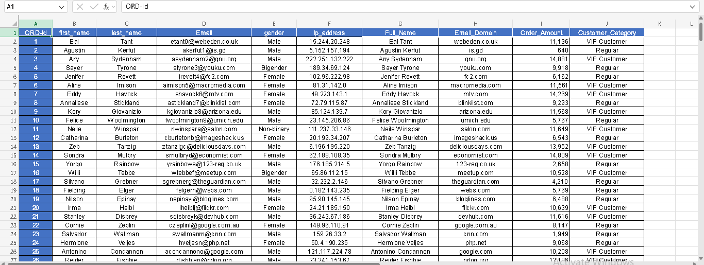

# 📊 Customer Sales Data Cleaning & MIS Report

An end-to-end **Data Cleaning and Management Information System (MIS) Reporting** project built in Microsoft Excel. This project transforms raw, unformatted customer transaction records (1,000+ rows) into clean, structured data and executive-level summary analytics.

---

## 🖼️ Project Preview

---

## 🚀 Key Tasks & Excel Techniques Used

* **Data Standardization & Text Manipulation:** Merged separate `first_name` and `last_name` columns into a standardized `Full_Name` field using `TEXTJOIN` / `CONCAT` formulas.
* **Email Domain Extraction:** Extracted corporate and personal email providers (`Email_Domain`) using dynamic text functions (`RIGHT`, `FIND`, `LEN`) for customer segmentation.
* **Automated Customer Tiering (Conditional Logic):** Categorized 1,000+ customers into **VIP Customers** (Orders ≥ 10,000) and **Regular Customers** using nested `IF` logic.
* **MIS Summary & Pivot Table Analytics:** Built a dynamic summary report analyzing total revenue (**3,217,373** Grand Total) segmented by customer gender and order volume.

---

## 📂 Files Included
* **`Customer_Sales_MIS_Report.xlsx`** — Complete Excel workbook containing the Raw Data, Cleaned Master Sheet, and MIS Pivot Summary.
* **`MIS_Summary_Preview.png`** — Visual snapshot of the final MIS summary report.

---

## 💼 Freelance Services Offered
Need help cleaning messy spreadsheets, automating reports, or building Excel dashboards? Feel free to connect via my Fiverr or Upwork profile listed in my bio!
